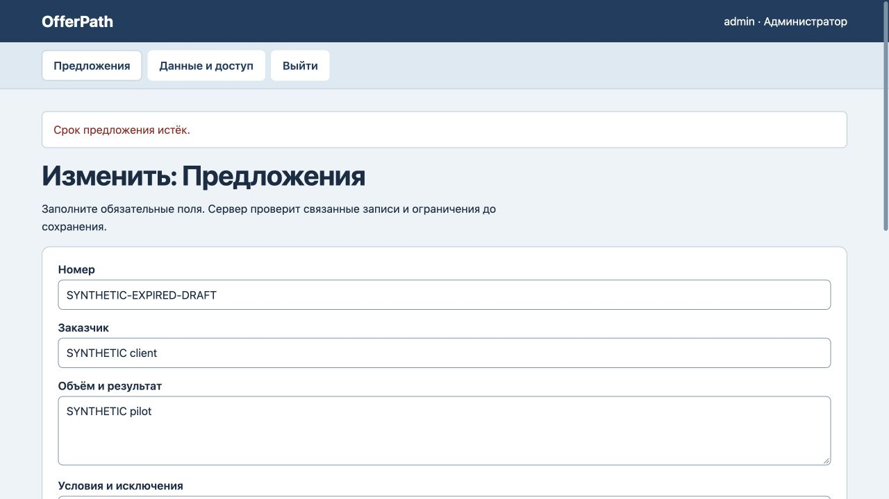
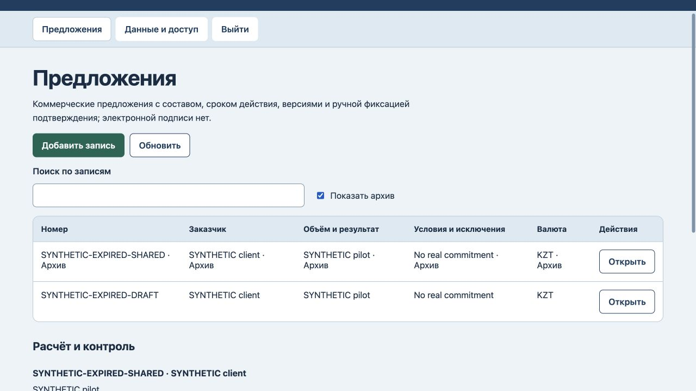

# OfferPath: срок и сохранность истории

25 октября 2026. Истёкшее ранее отправленное предложение блокировало несвязанные правки и восстановление копии. Две регрессии на переходе даты сначала завершились ошибкой. Теперь срок проверяется при новой отметке отправки, по дате UTC; ранее отправленная запись сохраняется без автоматической смены статуса. Новая просроченная отправка по-прежнему запрещена; после отдельного возврата в черновик можно задать новый срок. Проверены неизменность полей отправленного предложения, перезапуск и восстановление. В браузере другой черновик сохранён с ценой26000; попытка отметить его отправку отклонена, версия4/журнал4 и статус черновика сохранены. Старое предложение архивировано с прежними датой, ценой и статусом shared, версия5/журнал5; прочитано через Показать архив. Историческая запись не доказывает реальную отправку, согласие или договор.

Все 6 тестов прошли. [Машинная проверка](expiry-verification.json).

Сервер проверен локально. Новые внешние интеграции, клиентская приёмка и промышленное размещение не заявлены. Разметка и схема данных не менялись; новый полный аудит интерфейса или безопасности не проводился.
